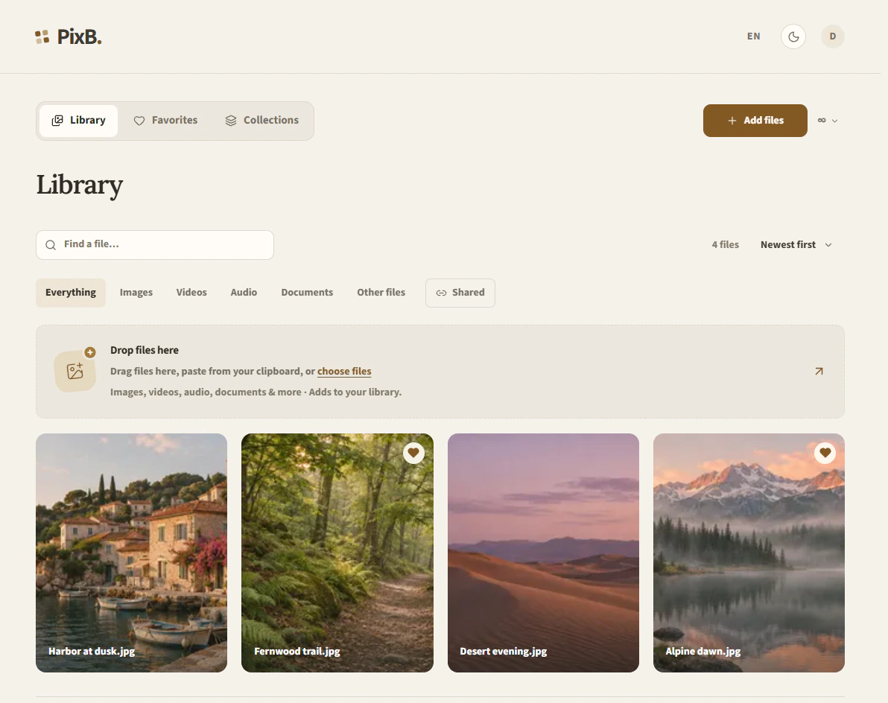

<div align="center">


# PixB

**A quiet, self-hosted library for your files.**

Drop something in, find it later, and share it when you want to.

[](https://github.com/Vulptik/pixb/actions/workflows/ci.yml)
[](https://github.com/Vulptik/pixb/releases/latest)
[](LICENSE)

[Install](#install) · [Features](#features) · [Privacy](#privacy) · [Develop](#develop) · [License](#license)

</div>



## Install

You'll need Docker Compose on a Linux x86-64 machine. Each release publishes ready-made app and database images, so all you download is the Compose file and its settings:

```sh
mkdir pixb && cd pixb
curl -fsSLO https://github.com/Vulptik/pixb/releases/latest/download/compose.production.yml
curl -fsSL -o .env https://github.com/Vulptik/pixb/releases/latest/download/env.example

docker compose -f compose.production.yml pull
docker compose -f compose.production.yml run --rm --no-deps init-config
docker compose -f compose.production.yml up -d --wait app
```

Open [localhost:3010/setup](http://localhost:3010/setup) to create the first administrator, then drop a file into the library. The app listens on localhost by default. The one-time initialization step creates the instance keys and database password.

Prefer to build the images yourself? Clone the repository and follow [build from source](docs/self-hosting.md#build-from-source).

> [!IMPORTANT]
> Keep the setup page local until you've created the first administrator. For remote access, see the [reverse proxy and public address guidance](docs/self-hosting.md#configuration).

Use fresh volumes for a new installation. To move to a newer release later, follow the [upgrade guide](docs/self-hosting.md#upgrade) and take a [backup](docs/self-hosting.md#back-up) first.

## Features

- **A private library for each account.** Drop in files, resume interrupted uploads, search by name, and filter by file type, favorites, or shared files.
- **Favorites and collections.** Put a file in several collections without making copies or changing who can access it.
- **Previews in the browser.** Browse images, videos, audio, and PDFs where your browser supports them. The original stays available to download.
- **Links you can revoke.** Choose which individual files to share. Anyone with an active link can open it, and revoking it disables the old link.
- **Account security and administration.** Sign in with passkeys or use authenticator codes as a second factor. Administrators can configure storage quotas, a per-file limit, and optional password-reset email.
- **An API for your own tools.** Upload, organize, and share files with scoped API keys. See the [file API](docs/api.md).
- **At home on desktop and mobile.** Light and dark themes, with the interface in English and French.

## Privacy

Files and generated previews stay on your server, with account and library metadata in PostgreSQL. PixB generates media previews with tools on the server. The Compose build disables Next.js telemetry, and browser assets, including fonts, are served by your instance. If you configure email, password-reset messages use the SMTP server you choose.

## Develop

Use Node.js 26.13.0, npm 12.2.1, and Docker Compose.

```sh
npm ci
npm run dev
```

Open [localhost:3001](http://localhost:3001). See [CONTRIBUTING.md](CONTRIBUTING.md) for local sign-in, checks and sending a change.

## How PixB is made

PixB is built with AI coding tools. I decide what PixB does, direct the work and check UI changes in the running app; the tools write much of the code. The test suite and its 90% coverage gate exist so every change has to prove itself, whoever or whatever wrote it.

## License

PixB is free software under the [GNU Affero General Public License v3.0 only](LICENSE). If you run a modified version for other people over a network, the license requires you to offer them its source. Bundled third-party components keep their own licenses; see [NOTICE.md](NOTICE.md).

The PixB name and logo are trademarks of Vulptik; forks must use their own. See the [trademark policy](TRADEMARKS.md). Found a security issue? See [SECURITY.md](SECURITY.md).
